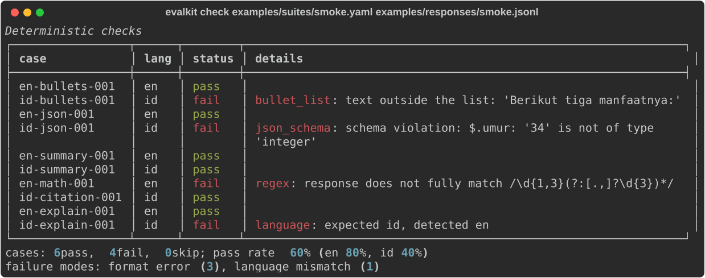
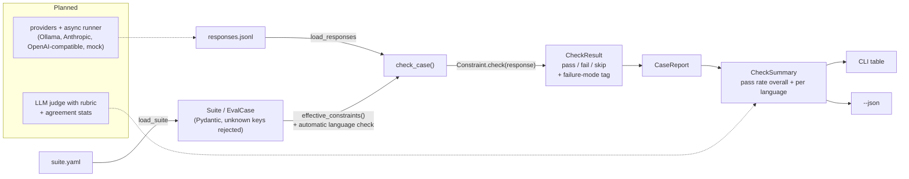

# llm-evalkit

A lightweight, bilingual (English / Bahasa Indonesia) harness for evaluating instruction-following and reasoning quality in LLM outputs.

[](https://github.com/Julminus/llm-evalkit/actions/workflows/ci.yml)

[](LICENSE)

> **Status: early (1 of 6 planned stages).** What exists today is the test-suite format and the
> deterministic checks. Model providers, the LLM-as-judge, judge-vs-human agreement statistics and
> HTML reports are planned; see [What's next](#whats-next).



<sub>Real output of `evalkit check` on the example suite. The 10 responses are hand-written to
show the output format, and 4 of them fail on purpose; they are not model results.</sub>

## Results

**Language check on real model output.** The language check matters most in a bilingual suite, so
it was measured on responses it had never seen. I generated 80 responses from two local models
(`qwen2.5:7b` and `llama3.1:8b`, Q4_K_M, via Ollama, temperature 0) to 20 everyday prompts, each
asked in English and in Indonesian. Then I read every response to record its true language: 39 EN,
39 ID, and 2 language-neutral ("Tokyo."). The detector was scored once, before any tuning.

| | Result |
|---|---|
| Responses it made a call on | **72 / 78 (92.3%)** |
| Calls that were correct | **72 / 72 (100%)** |
| Correct-language responses wrongly flagged as mismatched or mixed | **0** |
| Responses it declined to judge | 6, all under 10 words ("Yellow", "Kuning", "Halo, besok ada rapat.") |
| `langdetect` 1.0.9 (seeded) on the same rows | 72/72 on the decided rows; 3/6 on the short ones, with confident wrong guesses (Welsh for "Yellow", Lithuanian for "Kuningija"). It also labels the neutral "Tokyo." as Swahili. |

By length, the detector made a call on 3/9 responses under 10 words, 30/30 at 10–39 words and 39/39
at 40+ words. Read these numbers with their limits in mind. 72 out of 72 correct puts the error rate
below about 4% at 95% confidence (rule of three: 3 / 72), not at zero. All 80 responses came from
prompts I wrote myself. And none of them was actually in the wrong language, so the corpus tests how
well the detector tells EN from ID in both directions, not how it handles half-translated answers.
The corpus, the generation script and the scoring script are in the repo
(`tests/fixtures/langdetect_heldout.jsonl`, `scripts/`), and a regression test pins the numbers.

**Engineering.** 11 check types, 207 tests, 99.6% branch coverage, strict mypy. The suite passes
on Python 3.11.18, 3.12.10 and 3.13.18 (run locally). The Docker image is 220 MB.

## How it works



A suite is YAML. Each case has a prompt, the prompt's language, optional context and system
prompt, a list of **constraints** (deterministic checks), a **rubric** for the future LLM judge, and
tags:

```yaml
name: smoke
cases:
  - id: id-citation-001
    language: id
    context: "Pasal 2: Permohonan cuti diajukan paling lambat 14 hari sebelum ..."
    prompt: >-
      Kapan paling lambat karyawan harus mengajukan cuti? Sertakan rujukan
      dalam format [Pasal N] dan akhiri jawaban dengan "Semoga membantu."
    constraints:
      - {type: required_phrases, phrases: ["14 hari"]}
      - {type: regex, pattern: '\[Pasal \d+\]'}
      - {type: ends_with, text: "Semoga membantu."}
    rubric:
      criteria: ["Merujuk Pasal 2, bukan pasal lain."]
    tags: [grounded-qa, citation]
```

Every case also gets an automatic `language` check for its expected response language, unless it
sets `response_language: any` (for JSON or bare-number answers) or lists its own `language`
constraint.

| Type | Fails as | Checks |
|---|---|---|
| `word_count` | constraint_violation | word count in `[min, max]`; "anak-anak" and "don't" count as one word |
| `sentence_count` | constraint_violation | sentence count; knows EN/ID abbreviations (Dr., dll., Jl.), skips code and URLs |
| `paragraph_count` | constraint_violation | paragraphs separated by blank lines |
| `required_phrases` | constraint_violation | all (or any) phrases present; whole-word, case-insensitive by default |
| `forbidden_phrases` | constraint_violation | none of the phrases present |
| `regex` | constraint_violation | must / must not match; optional full match or match-count range |
| `json_schema` | format_error | valid JSON (bare or in one code fence) that validates against a JSON Schema |
| `bullet_list` | format_error | top-level list items in `[min_items, max_items]`; optional style and "list only" |
| `starts_with` / `ends_with` | format_error | prefix / suffix; ignores Markdown emphasis at the edge unless `loose: false` |
| `language` | language_mismatch | response is EN or ID; skips text with too few function words |

Any constraint can override its tag with `fails_as`. For example, a regex that enforces "answer
with the number only" is a `format_error`, not a `constraint_violation`.

## Quickstart

Needs [uv](https://docs.astral.sh/uv/). No API keys.

```bash
git clone https://github.com/Julminus/llm-evalkit.git && cd llm-evalkit
uv sync
uv run evalkit validate examples/suites/smoke.yaml
uv run evalkit check examples/suites/smoke.yaml examples/responses/smoke.jsonl
uv run pytest
```

`make setup`, `make test` and `make run` wrap the same commands. Useful flags:
`evalkit check --json` (machine-readable output), `--strict` (exit code 1 if any case fails, for CI)
and `-v` (show passing checks too). `evalkit list-checks` lists the constraint types. With Docker:
`docker build -t llm-evalkit . && docker run --rm -v "$PWD/examples:/work/examples" llm-evalkit check examples/suites/smoke.yaml examples/responses/smoke.jsonl`.

## Design decisions and trade-offs

- **Each constraint is one Pydantic class holding both its config and its check.**
  `{type: word_count, max: 80}` parses straight into `WordCount(max=80)` through a union keyed on
  `type`, and `.check(response)` lives on the same class. Adding a check means adding one class
  and its tests. Unknown keys and invalid configs (an uncompilable regex, an invalid JSON Schema,
  `min > max`) fail when the suite loads, not halfway through a run.
- **Three outcomes, not two.** A check can `pass`, `fail` or `skip`. The language of "42" can't be
  judged, and calling it a failure would make the harness report errors that aren't real. Skips
  don't count toward the pass rate.
- **Abstain instead of guessing.** The language detector only counts function words ("the", "is",
  "of" vs. "yang", "dan", "untuk"), using two disjoint word lists. That makes it deterministic and
  easy to explain. With fewer than two of those words it declines to judge. The table above shows
  why: a general-purpose detector guessed confidently wrong on half the short answers, and in an
  evaluator a confident wrong guess would mark a correct response as a `language_mismatch`.
- **The language check is on unless a case turns it off.** In a bilingual suite, answering in the
  wrong language fails the task whatever else is right. So a case author who forgets to add the
  check still gets it.
- **Words are counted the way an Indonesian reader counts them.** Reduplicated words ("anak-anak",
  "kupu-kupu") and numbers with separators ("Rp 50.000") are one word each. That differs from
  IFEval's `\w+` tokenizer, so word counts here aren't directly comparable with IFEval scores.
- **Lenient by default where a reader wouldn't notice the difference.** `ends_with: "Selesai."`
  accepts `**Selesai.**`, and `json_schema` accepts JSON inside a single code fence. Each check has a
  strict switch (`loose: false`, `allow_code_fence: false`) for cases where the exact format is the
  point.
- **Deterministic checks first, the judge later.** These checks cost nothing to run and give the
  same answer every time, so they run on every response. The LLM judge (next stage) is reserved for
  what really needs judgment, like faithfulness and reasoning quality. Both use the same
  failure-mode taxonomy, so the two kinds of result can be counted together.

**Known limits.** Malay shares most Indonesian function words and is detected as Indonesian.
Heavily colloquial Indonesian is recognised through the function words it still uses ("kita",
"bisa", "lagi"), but slang forms ("gak", "udah") aren't in the lists. Sentence splitting is
rule-based: it covers common abbreviations, not every abbreviation.

## What's next

1. **Providers and runner:** Ollama, Anthropic, OpenAI-compatible and a deterministic `mock` (for
   CI), plus an async runner with concurrency limits, retries, an on-disk response cache and JSONL
   run logs.
2. **LLM-as-judge:** rubric scores from 1 to 5 for instruction following, reasoning quality,
   faithfulness and helpfulness, with failure-mode tags and repair of malformed judge JSON.
3. **Judge reliability:** weighted Cohen's kappa, Spearman correlation and confusion matrices
   against human labels; pairwise mode with position-bias detection; self-consistency.
4. **Reports:** HTML and Markdown reports, model-vs-model comparison, regression diffs between runs.
5. **Benchmark:** a hand-written 40-item EN/ID suite run on local models, with findings.

## License

MIT
