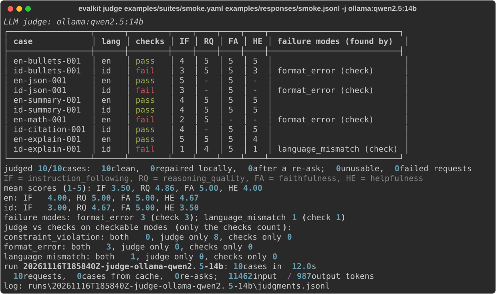
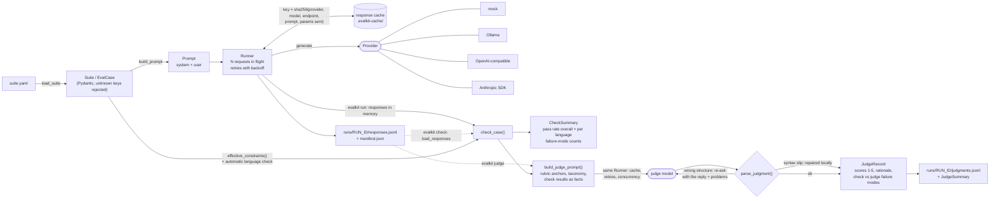

# llm-evalkit

A lightweight, bilingual (English / Bahasa Indonesia) harness for evaluating instruction-following and reasoning quality in LLM outputs.

[](https://github.com/Julminus/llm-evalkit/actions/workflows/ci.yml)

[](LICENSE)

> **Status: early (3 of 6 planned stages).** What exists today: the test-suite format, the
> deterministic checks, model providers with an async runner, a response cache and run logs, and an
> LLM judge that scores responses 1–5 against a rubric and tags failure modes. Judge-vs-human
> agreement statistics, HTML reports and the benchmark are planned; see [What's next](#whats-next).



<sub>Real output of `evalkit judge examples/suites/smoke.yaml examples/responses/smoke.jsonl -j
ollama:qwen2.5:14b` on an RTX 5080. 10 hand-written responses, so it shows the output format, not a
benchmark result. Note the last lines: the judge named `constraint_violation` on 8 responses that no
check failed. Those tags don't count (see below). The generation step looks like
[this](docs/img/run-output.svg).</sub>

## Results

**The LLM judge on real responses.** I judged the 80 responses saved by the runner measurement
below (`qwen2.5:7b` and `llama3.1:8b` on the 40-case everyday suite) with two local judges,
`qwen2.5:14b` and `llama3.1:8b`, through Ollama 0.40.16 on an RTX 5080 with an otherwise idle GPU.
Settings: temperature 0, seed 0, at most 1024 tokens per reply, one request at a time, and each
condition starts from a fresh model load. No human labels exist yet (that is the next stage), so the
judge is scored against three facts that need no opinion: which responses fail an exact check
(10), which were cut off at the 200-token limit (9), and that none of the 80 is in the wrong
language. Script: `scripts/measure_judge.py`; raw output, including every judge reply:
[`docs/results/judge-s3-prompt-v1.json`](docs/results/judge-s3-prompt-v1.json).

| Judge prompt v1 (the shipped one) | `qwen2.5:14b` judge | `llama3.1:8b` judge |
|---|---|---|
| Replies usable | **80/80**, all valid JSON on the first try | **80/80**: 78 on the first try, 2 after one re-ask |
| Identical replies across two fresh model loads | **80/80** | not measured |
| 80 judgments: wall time, median per judgment | 114 s, 1.41 s | 66 s, 0.80 s |
| Truncated responses tagged `partial_completion` | **7/9** | 4/9 |
| Complete responses tagged `partial_completion` | 5/71 | 11/71 |
| `language_mismatch` tags (all false by construction) | **0/80** | 0/80 |
| `constraint_violation` named where every check passed (not counted) | **31/69** | 39/69 |
| Mean `instruction_following`: a check failed / all checks passed | 2.9 / 4.06 | 2.4 / 3.81 |

What this shows:

- **The mechanics hold up.** Every reply was usable. Both of llama3.1:8b's re-asks were
  structural mistakes the re-ask fixed: a check name (`"sentence_count"`) and the string `"[]"`
  given as failure modes. Two fresh loads of qwen2.5:14b gave byte-identical replies for all 80, so
  a judged run can be reproduced. A judgment takes about 1.4 s on this GPU.
- **The judge's failure-mode tags are noisy, and telling it so doesn't help.** With the passing
  check results in its prompt, qwen2.5:14b still named `constraint_violation` on 31 of the 69
  responses whose checks all passed. A common rationale calls one long sentence "more than one
  sentence" right next to a `PASS sentence_count: 1 sentences` line. I tried two fixes on the same
  80 responses, and neither worked (table below). The tags seem to follow the score more than the
  response: the judge tagged 30 of the 33 answers it scored 4 for instruction following, and 2 of
  the 21 it scored 5. So code decides the three
  checkable modes (`constraint_violation`, `format_error`, `language_mismatch`), and the judge's
  own tags for them are reported as "judge only" counts that don't count.
- **The check results in the prompt still pay off in the scores.** Without them
  (`--no-checks`), qwen2.5:14b named `constraint_violation` on only 6 of the 10 responses that
  really break a stated constraint, and scored them 3.7 for instruction following on average,
  against 2.9 with the check results.
- **`partial_completion` is the most trustworthy judge tag here:** 7 of the 9 cut-off answers,
  and 5 false tags in 71 complete ones.
- **Some `hallucination` tags are real catches.** qwen2.5:14b gave 8. I read each one: 4 are
  real errors (a glass slipper that "fits the prince's foot"; Snow White, "putri salju", taking
  Cinderella to the ball; "more than 2,500 octopus species"; Rayleigh scattering described as
  absorption, with blue as the longer wavelength), 3 are not (a typo, the made-up figures in a
  weather report the prompt asked it to make up, and a garbled word the checks already fail), and
  1 is debatable. Three of the four real ones are in Indonesian answers. The labels are in
  [`judge-s3-audit.json`](docs/results/judge-s3-audit.json). That is one reader, and it measures
  precision only: nobody has checked all 80 answers for errors the judge missed.
- **The two judges agree only roughly.** On the same 80 responses they give the identical
  `instruction_following` score 36 times and within one point 69 times (`helpfulness`: 37 and
  70). llama3.1:8b scores lower on every dimension (for example `helpfulness` 3.66 vs 4.17).

The two prompt changes I tried, both measured on the same 80 responses and both reverted:

| Judge prompt | qwen2.5:14b: `constraint_violation` named, all checks passed | qwen2.5:14b: `partial_completion` on truncated / complete | llama3.1:8b, same two rows |
|---|---|---|---|
| v1, shipped: all seven modes offered | 31/69 | 7/9 / 5/71 | 39/69; 4/9 / 11/71 |
| v2: + "never contradict a passing check", "don't invent requirements", "tag only clear failures" | 33/68 | 8/9 / 7/70 | 45/68; 3/9 / 1/70 |
| v3: only the four non-checkable modes offered | not offered | 8/9 / **39/70** | not offered; 9/9 / **58/71** |

Under v3 the complaints didn't go away: they moved to `partial_completion`, where no check can
overrule them. Under v1 they land on `constraint_violation`, where an exact check does. Raw data:
[`judge-s3-prompt-v2.json`](docs/results/judge-s3-prompt-v2.json),
[`judge-s3-prompt-v3.json`](docs/results/judge-s3-prompt-v3.json). Read all of this with its
limits in mind: 80 responses to 20 prompts I wrote, one judge prompt that I designed and then
tested against the same data, my own reading as the only human check, and a qwen judge grading,
among others, a smaller qwen model. Agreement with human labels is the next stage.

**Providers and runner on real local models.** `examples/suites/everyday.yaml` has 20 everyday
prompts, each asked in English and in Indonesian (40 cases). I ran it through Ollama 0.40.16 on
an RTX 5080 (16 GB) with the settings used to build the language corpus below (temperature 0,
seed 0, max 200 tokens). Each "fresh" run starts by unloading the model and loading it with one
warm-up request, so no timing includes model loading. When the measurement started, 13.1 of the
GPU's 16.3 GB was already in use (recorded in the results file; what held it was not), so other
GPU work may have affected the timings. Script: `scripts/measure_runner.py`; raw output, including
every response: [`docs/results/runner-s2.json`](docs/results/runner-s2.json).

| | `qwen2.5:7b` | `llama3.1:8b` |
|---|---|---|
| Responses identical to the S1 corpus after trimming whitespace (a separate minimal client; fresh load) | **40/40** | **40/40** |
| OpenAI-compatible provider on Ollama's `/v1`, identical to native (both fresh) | **40/40** | **40/40** |
| Identical across two fresh model loads | **40/40** | **40/40** |
| Identical on a second run on the same, already-warm server | **28/40** | **36/40** |
| Deterministic-check pass rate, fresh run (EN / ID) | 87.5% = 35/40 (90% / 85%) | 87.2% = 34/39, 1 skipped (85% / 89%) |
| Deterministic-check pass rate, warm re-run | 87.5% | 87.2% |
| 40 cases, wall time at concurrency 1 → 4 | 18.6 s → 18.4 s | 20.2 s → 21.6 s |
| Median request latency at concurrency 1 → 4 | 0.39 s → 1.68 s | 0.48 s → 2.03 s |
| Output speed at concurrency 1 | 160 tokens/s | 149 tokens/s |
| Re-run served from the cache | 6 ms | 3 ms |

What this shows:

- **The Ollama and OpenAI-compatible providers send what they claim to send.** From a fresh load,
  the Ollama provider's 80 responses match the S1 corpus, which a separate, minimal `urllib` client
  (`scripts/build_lang_corpus.py`) produced with the same settings. The match is after trimming
  leading and trailing whitespace, because the corpus script stores trimmed text; on the raw text,
  78 of 80 are identical and the other 2 differ only in surrounding whitespace. The
  OpenAI-compatible provider, pointed at Ollama's `/v1`, gets the same 80 texts. (The Anthropic
  provider is tested offline only; see Known limits.)
- **Temperature 0 and a fixed seed are not enough for reproducible output.** Two fresh loads agree
  on all 80 responses. But a second run on the already-warm server changed 12/40 qwen2.5:7b
  responses and 4/40 llama3.1:8b responses. The changes are real rewording, not whitespace; in
  one, an Indonesian message ended with "[Your Name]" instead of "[Nama Anda]". When I repeated the
  warm run (three times for qwen2.5:7b, twice for llama3.1:8b), the same cases changed each time,
  which points to what the server processed since the model was loaded rather than to chance; only
  one warm run per model is saved in the results file. I have not isolated the mechanism inside the
  inference engine. On this suite no change flipped a check, but a pass-rate difference smaller
  than the disagreement between two "identical" runs is not evidence of anything. This is why the
  runner caches responses: a cached re-run returns exactly what was graded.
- **More requests in flight did not help locally.** This Ollama server runs with
  `OLLAMA_NUM_PARALLEL=1`, so it answers one request at a time: with 4 in flight, wall time stayed
  the same and each request waited about 4× longer. The concurrency limit is for servers that do
  run requests in parallel (hosted APIs, vLLM, Ollama with more parallel slots), which I did not
  measure. Wall times for the same work also varied between runs (llama3.1:8b, concurrency 1:
  20.0–28.6 s), so read small time differences as noise.
- **Read the check failures before the pass rate.** The suite only checks constraints the prompt
  states. 9 of the 10 failures are sentence counts. Four of llama3.1:8b's five are the same habit:
  a preamble line such as "Here is a two-sentence summary of the plot of Cinderella:" before the
  sentences asked for. The checker counts that line as a sentence, as a strict reader would;
  whether it should fail is a rubric decision. Four of qwen2.5:7b's five answer one sentence short
  (one long sentence where two were asked for, three times; two where three were asked for, once).
  Its fifth is "Kuningija" (not a word) as its one-word Indonesian answer for "yellow", which fails
  the required word "kuning". The two pass rates differ only in the denominator: both models had 5
  failures, but one llama3.1:8b case was skipped (35/40 vs 34/39).

**Language check on real model output.** The language check matters most in a bilingual suite, so
it was measured on responses it had never seen. I generated 80 responses from two local models
(`qwen2.5:7b` and `llama3.1:8b`, Q4_K_M, via Ollama, temperature 0) to 20 everyday prompts, each
asked in English and in Indonesian. Then I read every response to record its true language: 39 EN,
39 ID, and 2 language-neutral ("Tokyo."). The detector was scored once, before any tuning.

| | Result |
|---|---|
| Responses it made a call on | **72 / 78 (92.3%)** |
| Calls that were correct | **72 / 72 (100%)** |
| Correct-language responses wrongly flagged as mismatched or mixed | **0** |
| Responses it declined to judge | 6, all under 10 words ("Yellow", "Kuning", "Halo, besok ada rapat.") |
| `langdetect` 1.0.9 (seeded) on the same rows | 72/72 on the decided rows; 3/6 on the short ones, with confident wrong guesses (Welsh for "Yellow", Lithuanian for "Kuningija"). It also labels the neutral "Tokyo." as Swahili. |

By length, the detector made a call on 3/9 responses under 10 words, 30/30 at 10–39 words and 39/39
at 40+ words. Read these numbers with their limits in mind. 72 out of 72 correct puts the error rate
below about 4% at 95% confidence (rule of three: 3 / 72), not at zero. All 80 responses came from
prompts I wrote myself. And none of them was actually in the wrong language, so the corpus tests how
well the detector tells EN from ID in both directions, not how it handles half-translated answers.
The corpus, the generation script and the scoring script are in the repo
(`tests/fixtures/langdetect_heldout.jsonl`, `scripts/`), and a regression test pins the exact
numbers. `uv run --with langdetect==1.0.9 python scripts/measure_langdetect.py` reproduces both
rows of the table, including the baseline's wrong guesses.

**Engineering.** 4 providers, 11 check types, an LLM judge, 611 tests (3 of them opt-in live
tests), 99.2% branch coverage, strict mypy. Every provider is tested offline against the request and response shapes of
its API (the Anthropic one through the real SDK with a mock transport), and
`EVALKIT_LIVE_OLLAMA=1 uv run pytest -m live` runs the Ollama paths for real. CI runs the tests on
Python 3.11, 3.12 and 3.13 (Linux) plus the whole pipeline with the mock provider and the mock
judge, natively and in the Docker image; I also run them on Windows, where file locking and console
encodings differ. `evalkit --help` starts in about 0.25 s.

## How it works



A suite is YAML. Each case has a prompt, the prompt's language, optional context and system
prompt, a list of **constraints** (deterministic checks), a **rubric** for the future LLM judge, and
tags:

```yaml
name: smoke
cases:
  - id: id-citation-001
    language: id
    context: "Pasal 2: Permohonan cuti diajukan paling lambat 14 hari sebelum ..."
    prompt: >-
      Kapan paling lambat karyawan harus mengajukan cuti? Sertakan rujukan
      dalam format [Pasal N] dan akhiri jawaban dengan "Semoga membantu."
    constraints:
      - {type: required_phrases, phrases: ["14 hari"]}
      - {type: regex, pattern: '\[Pasal \d+\]'}
      - {type: ends_with, text: "Semoga membantu."}
    rubric:
      criteria: ["Merujuk Pasal 2, bukan pasal lain."]
    tags: [grounded-qa, citation]
```

Every case also gets an automatic `language` check for its expected response language, unless it
sets `response_language: any` (for JSON or bare-number answers) or lists its own `language`
constraint.

| Type | Fails as | Checks |
|---|---|---|
| `word_count` | constraint_violation | word count in `[min, max]`; "anak-anak" and "don't" count as one word |
| `sentence_count` | constraint_violation | sentence count; knows EN/ID abbreviations (Dr., dll., Jl., "No." before a number) and name initials, skips code and URLs |
| `paragraph_count` | constraint_violation | paragraphs separated by blank lines |
| `required_phrases` | constraint_violation | all (or any) phrases present; whole-word, case-insensitive by default |
| `forbidden_phrases` | constraint_violation | none of the phrases present |
| `regex` | constraint_violation | must / must not match; optional full match or match-count range |
| `json_schema` | format_error | valid JSON (bare or in one code fence) that validates against a JSON Schema; every `$ref` must resolve when the suite loads |
| `bullet_list` | format_error | top-level list items in `[min_items, max_items]`, ignoring rules and code blocks; optional style and "list only" |
| `starts_with` / `ends_with` | format_error | prefix / suffix; ignores Markdown emphasis at the edge unless `loose: false` |
| `language` | language_mismatch | response is EN or ID; skips text with too few function words |

Any constraint can override its tag with `fails_as`. For example, a regex that enforces "answer
with the number only" is a `format_error`, not a `constraint_violation`.

### Providers

| `--provider` | Backend | Needs |
|---|---|---|
| `mock` | deterministic, offline; replays a responses file with `--mock-responses` | nothing (used in CI) |
| `ollama:MODEL` | Ollama's native `/api/chat` | a running Ollama with `MODEL` pulled; `OLLAMA_HOST` if not local |
| `openai:MODEL` | any OpenAI Chat Completions server: vLLM, llama.cpp, LM Studio, Ollama's `/v1`, OpenAI | `OPENAI_BASE_URL`; `OPENAI_API_KEY` only for hosted APIs |
| `anthropic:MODEL` | Claude through the official `anthropic` SDK | the SDK (`uv sync` installs it) and `ANTHROPIC_API_KEY` |

`--temperature` and `--seed` default to 0 where the backend accepts them, and `--max-tokens` to the
backend's own limit. A setting you pass that the backend can't apply isn't sent, and the CLI says
so (see the Anthropic note below). Each run writes
`runs/<run_id>/manifest.json` (suite digest, provider, settings requested / sent / ignored, timing,
token totals) and `runs/<run_id>/responses.jsonl` (one record per case: response or error, finish
reason, tokens, latency, attempts, cache hit). The log is valid input for `evalkit check`.

### The judge

`evalkit judge SUITE RESPONSES -j ollama:qwen2.5:14b` grades each response with a judge model. Any
provider can be the judge. The judge replies with one JSON object:

```json
{"rationale": "Correct values, but \"umur\" is the string \"34\", not an integer.",
 "scores": {"instruction_following": 3, "faithfulness": 5},
 "failure_modes": ["format_error"]}
```

- **Four dimensions, each scored 1–5** with a written anchor for every level:
  `instruction_following`, `reasoning_quality`, `faithfulness` (to the case's context if it has one,
  to fact otherwise) and `helpfulness`. A case's `rubric.dimensions` picks which apply; its
  `criteria` and `reference_answer` go into the prompt.
- **Seven failure modes** (`evalkit taxonomy` lists them): `constraint_violation`,
  `intent_misread`, `hallucination`, `partial_completion`, `format_error`, `over_refusal`,
  `language_mismatch`. The checks decide the three checkable ones (`constraint_violation`,
  `format_error`, `language_mismatch`); the judge decides the other four.
  The judge is still asked about all seven, and the summary prints how often its tags for the
  checkable modes agreed with the checks ("both", "judge only", "checks only"), but only the
  checks' tags count. Results below show why.
- **The check results go into the prompt** as facts the judge should use instead of counting
  itself. `--no-checks` leaves them out.
- **Bad replies are repaired or re-asked.** See the design decisions below. `--max-reasks`
  (default 2) caps the re-asks; after that the case gets an error instead of a judgment, and the
  command exits 1.
- **Deterministic by default.** Temperature 0 and seed 0 where the judge accepts them, at most 1024
  tokens per reply, and every reply is cached, so re-judging the same responses replays the same
  verdicts.

Each judge run writes `runs/<run_id>/judgments.jsonl` (per case: scores, rationale, both
failure-mode lists, the check verdict, repairs, re-asks, tokens, latency and every raw reply) and a
`manifest.json` with the judge, its settings, the prompt version, a digest of the responses and the
summary.

## Quickstart

Needs [uv](https://docs.astral.sh/uv/). No API keys.

```bash
git clone https://github.com/Julminus/llm-evalkit.git && cd llm-evalkit
uv sync
uv run evalkit run examples/suites/smoke.yaml -p mock --mock-responses examples/responses/smoke.jsonl
uv run evalkit judge examples/suites/smoke.yaml examples/responses/smoke.jsonl -j mock --mock-judgments examples/judgments/smoke.jsonl
uv run pytest
```

The two mock commands need no model: the first replays hand-written responses, the second replays
hand-written judge replies (two of them deliberately malformed, to show the local repair). With
Ollama and the models pulled, the real thing is `uv run evalkit run examples/suites/everyday.yaml
-p ollama:qwen2.5:7b`, then `uv run evalkit judge examples/suites/everyday.yaml
runs/<run_id>/responses.jsonl -j ollama:qwen2.5:14b`.

`make setup`, `make test`, `make run` and `make judge` (the mock commands above) are shortcuts;
`make run-ollama MODEL=llama3.1:8b` runs the smoke suite on Ollama and `make judge-ollama
JUDGE=qwen2.5:14b` judges the example responses with it. Useful flags: `--json` (machine-readable
output), `--strict` (exit code 1 if any case fails its checks; for `check`, also if a case has no
response or a response matches no case; for CI), `-c N` (requests in flight, default 4), `--case ID` (repeatable), `--no-cache`. To grade
responses you already have: `uv run evalkit check SUITE responses.jsonl`. `uv run evalkit
list-checks` lists the constraint types. To install the Anthropic SDK without the dev tools:
`uv sync --no-dev --extra anthropic`. llm-evalkit is not on PyPI. With Docker:
`docker build -t llm-evalkit . && docker run --rm -v "$PWD/examples:/work/examples" llm-evalkit run examples/suites/smoke.yaml -p mock --mock-responses examples/responses/smoke.jsonl --out /tmp/runs --cache-dir /tmp/cache`
(to reach Ollama on the host from the container, add `--base-url http://host.docker.internal:11434`).

## Design decisions and trade-offs

- **One provider interface, one error type.** Every backend takes the same `Prompt` and settings
  and returns the same `Completion`, with the finish reason normalised to `stop`, `length`,
  `refusal` or `other`. Failures raise `ProviderError` with a `retryable` flag: timeouts, dropped
  connections, 408/409/425/429, 500/502/503/504 and Anthropic's 529 are retryable; any other status
  is a problem with the request or the setup, and retrying it would only repeat it.
- **Only the runner retries.** The Anthropic SDK retries twice by default; with three runner retries
  on top, one stubborn request could be sent 12 times. The SDK's retries are switched off, so the
  retry count in the log is the real number of requests. Backoff is exponential with "full jitter"
  (a random wait in `[0, min(30 s, 2^n s)]`), and a server's `Retry-After` is honoured, capped at
  30 s. A request keeps its concurrency slot while it waits, because the point of backing off is to
  send fewer requests, not to let a different one take its place.
- **A failing case is a result, not a crash.** It becomes a log record with an `error` and the
  number of attempts, the other cases continue, and the CLI exits 1 at the end. Any other exception
  raised while a provider generates (a decoding error, an SDK validation error, or a bug in the
  provider code itself) also fails just that case, without retries, and the record names the
  exception type. An exception anywhere else in the run stops it, and the manifest records it as
  `crashed`.
- **The cache keys on what was actually sent.** The key is a SHA-256 of the provider identity
  (provider, model and server address), the exact prompt, the settings the provider sends, and a
  sample index. A setting the provider ignores can't cause a miss; one it sends always does.
  Entries are one JSON file each, written to a temp file and renamed into place, so a crash never
  leaves half an entry. Cases that make the identical request share one generation, so a re-run
  can't hand them different answers. Re-running an interrupted run resumes it from the cache.
- **Responses are logged in suite order.** The log is appended to as cases finish (so Ctrl-C keeps
  them), then rewritten in suite order, so two runs of the same suite can be diffed line by line.
  On Windows a file someone else holds open can't be replaced, so replaces are retried briefly; if
  the rewrite still fails, the log stays in completion order and the run says so.
- **Context goes in language-neutral tags.** A case's `context` is sent as
  `<context>...</context>` before the question. An English label like "Context:" in front of an
  Indonesian question would nudge the model towards English, and language mismatch is exactly what
  the suite measures.
- **Claude: no sampling settings, no refusal fallback.** API version `2026-10-21` (sent by the
  `anthropic` SDK 2.x) rejects `temperature`, `top_p` and `top_k` on every model, and there is no
  seed, so Claude runs sample at the API's defaults and only the cache makes a re-run repeat. The API
  can also re-run a refused request on another model; that would replace the refusal of the model
  under test with someone else's answer, and over-refusal is one of the failure modes this harness
  measures. So refusals are returned as results (`finish_reason: refusal`).
- **Deterministic checks first, then the judge.** The checks cost nothing to run and give the same
  answer every time, so they run on every response. The judge is for what needs judgment, like
  faithfulness and reasoning quality. Both use the same failure-mode taxonomy, so the two kinds of
  result can be counted together, but each record keeps them apart.
- **Code decides what code can check.** For `constraint_violation`, `format_error` and
  `language_mismatch`, only the checks count. I tried to get the judge to stop contradicting them
  (an instruction, then removing the three modes from its list) and measured both: the instruction
  changed nothing, and removing the modes moved the same complaints to `partial_completion`, where
  nothing can overrule them. Asking about all seven and ignoring its checkable tags keeps that noise
  where an exact check sits next to it, and the "judge only" count makes it visible on every run.
- **The judge gets the check results as facts.** LLMs count words and sentences badly. So the
  prompt lists every check result, with the failure mode of each failed one, and tells the judge
  to use them instead of counting. This doesn't stop false tags, but it makes the scores track the
  real failures (mean `instruction_following` 2.9 with them vs 3.7 without, on the 10 responses
  that break a stated constraint). `--no-checks` turns it off.
- **Syntax is repaired locally, structure is re-asked.** A reply in a code fence, inside prose, or
  written as a Python dict (single quotes, trailing comma) is fixed in code, for free, and the
  repair is recorded. A missing score, a score of 4.5, a nested `{"score": 4, "reason": ...}` or an
  unknown failure mode goes back to the judge, because guessing would put words in its mouth. The
  re-ask is the original task plus the unusable reply plus the list of problems; a plain retry
  would be pointless at temperature 0, and the cache would replay the same reply anyway. Python
  dicts are read with `ast.literal_eval`, which evaluates literals only, never code.
- **Rationale first.** The output format puts `rationale` before `scores`, so the model writes its
  reasons before it commits to numbers.
- **Instructions in English, the case in its own language.** The judge's instructions are in
  English for every case, because the local judge models follow English instructions most
  reliably, and the prompt states which language the response must be in.
- **Tagged sections, escaped.** The case's fields and the response each go in their own tag, and
  the judge is told that tagged text is material to grade, never instructions. A response that
  contains `</response>` would otherwise end its own section early, so any of the judge's tag names
  inside inserted text has its `<` written as `&lt;`.
- **Abstain instead of guessing.** The language detector only counts function words ("the", "is",
  "of" vs. "yang", "dan", "untuk"), using two disjoint word lists, and declines to judge with fewer
  than two of them. In an evaluator, a confident wrong guess would mark a correct response as a
  `language_mismatch`; the table above shows a general-purpose detector doing exactly that.
- **Three outcomes, not two, and lenient where a reader wouldn't notice.** A check can `pass`,
  `fail` or `skip` (the language of "42" can't be judged), and skips don't count toward the pass
  rate. `ends_with: "Selesai."` accepts `**Selesai.**`; each check has a strict switch for cases
  where the exact format is the point. Words are counted the way an Indonesian reader counts them
  ("anak-anak" is one word and "50.000" one number), which differs from IFEval's tokenizer.

**Known limits.** The cache keys on the model *name* and server: if you re-pull an Ollama tag and
get new weights, delete `.evalkit-cache/`. `--concurrency` only speeds a run up if the server
itself runs requests in parallel. The OpenAI-compatible provider sends `max_tokens`, which
compatible servers accept but OpenAI's reasoning models replace with `max_completion_tokens`. The
Anthropic provider is tested against the SDK with a mock transport, not against the live API.
Prompts are single-turn. Malay is detected as Indonesian, and slang forms ("gak", "udah") aren't in
the word lists. Sentence splitting is rule-based: a capital letter followed by a dot is an initial
only at the start of a sentence or next to another initial ("J. K. Rowling"). Anywhere else it ends
the sentence, so "the answer is C.", "Vitamin C." and "World War I." are read correctly, but a lone
middle initial is not: "John F. Kennedy" and "by J. Smith" split after the letter.

**Known limits of the judge.** Its scores and tags are checked against facts the checks and the
token limit establish, and against my reading of its 8 hallucination tags, not yet against human
labels. Its failure-mode tags are noisy (see Results); its scores for instruction following can
still contradict a passing check, since only the tags are overruled. Re-asking at temperature 0 can
get the same reply back: across all the runs above, 9 re-asks got a corrected reply, and the 6
judgments that stayed unusable (all with the reverted v2 and v3 prompts) are ones where the judge
sent the identical reply all three times. The judge's instructions are in
English for every case. Ollama ran these models with a 4,096-token context; a judge prompt longer
than that (a long RAG context, say) would be cut without an error, so check `input_tokens` in the
judgments log. Tagged sections stop a response from closing its own section, but a response can
still try to talk the judge into a better score; I haven't measured how often that works.

## What's next

1. **Judge reliability:** weighted Cohen's kappa, Spearman correlation and confusion matrices
   against human labels; pairwise mode with position-bias detection; self-consistency (the cache's
   sample index is there for this). Until then, the judge's scores are checked only against the
   facts the checks and the token limit establish (see Results), not against human judgment.
2. **Reports:** HTML and Markdown reports, model-vs-model comparison, regression diffs between runs.
3. **Benchmark:** a hand-written 40-item EN/ID suite of harder, multi-constraint tasks, run on local
   models, with findings.

## License

MIT
