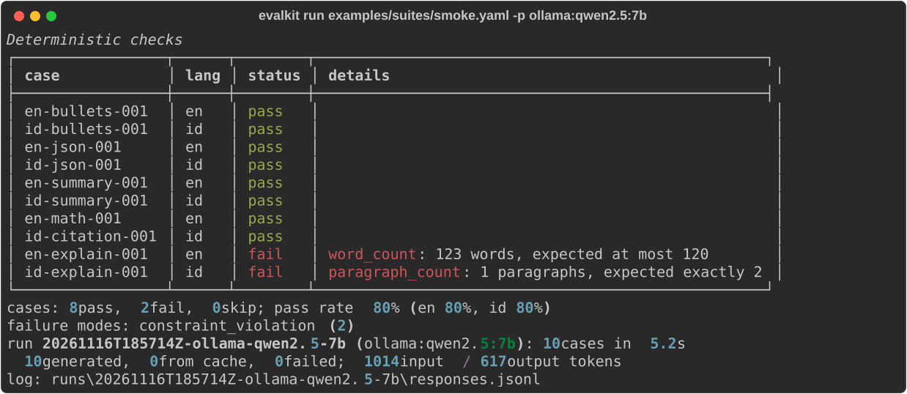
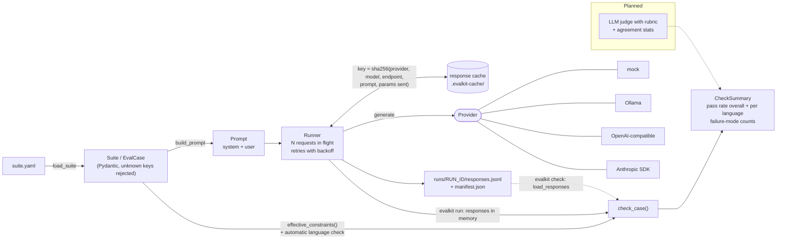

# llm-evalkit

A lightweight, bilingual (English / Bahasa Indonesia) harness for evaluating instruction-following and reasoning quality in LLM outputs.

[](https://github.com/Julminus/llm-evalkit/actions/workflows/ci.yml)

[](LICENSE)

> **Status: early (2 of 6 planned stages).** What exists today: the test-suite format, the
> deterministic checks, and model providers with an async runner, a response cache and run logs.
> The LLM-as-judge, judge-vs-human agreement statistics and HTML reports are planned; see
> [What's next](#whats-next).



<sub>Real output of `evalkit run examples/suites/smoke.yaml -p ollama:qwen2.5:7b` on an RTX 5080.
10 cases, so it shows the output format; it is not a benchmark result.</sub>

## Results

**Providers and runner on real local models.** `examples/suites/everyday.yaml` has 20 everyday
prompts, each asked in English and in Indonesian (40 cases). I ran it through Ollama 0.40.16 on
an RTX 5080 (16 GB) with the settings used to build the language corpus below (temperature 0,
seed 0, max 200 tokens). Each "fresh" run starts by unloading the model and loading it with one
warm-up request, so no timing includes model loading. When the measurement started, 13.1 of the
GPU's 16.3 GB was already in use (recorded in the results file; what held it was not), so other
GPU work may have affected the timings. Script: `scripts/measure_runner.py`; raw output, including
every response: [`docs/results/runner-s2.json`](docs/results/runner-s2.json).

| | `qwen2.5:7b` | `llama3.1:8b` |
|---|---|---|
| Responses identical to the S1 corpus after trimming whitespace (a separate minimal client; fresh load) | **40/40** | **40/40** |
| OpenAI-compatible provider on Ollama's `/v1`, identical to native (both fresh) | **40/40** | **40/40** |
| Identical across two fresh model loads | **40/40** | **40/40** |
| Identical on a second run on the same, already-warm server | **28/40** | **36/40** |
| Deterministic-check pass rate, fresh run (EN / ID) | 87.5% = 35/40 (90% / 85%) | 87.2% = 34/39, 1 skipped (85% / 89%) |
| Deterministic-check pass rate, warm re-run | 87.5% | 87.2% |
| 40 cases, wall time at concurrency 1 → 4 | 18.6 s → 18.4 s | 20.2 s → 21.6 s |
| Median request latency at concurrency 1 → 4 | 0.39 s → 1.68 s | 0.48 s → 2.03 s |
| Output speed at concurrency 1 | 160 tokens/s | 149 tokens/s |
| Re-run served from the cache | 6 ms | 3 ms |

What this shows:

- **The Ollama and OpenAI-compatible providers send what they claim to send.** From a fresh load,
  the Ollama provider's 80 responses match the S1 corpus, which a separate, minimal `urllib` client
  (`scripts/build_lang_corpus.py`) produced with the same settings. The match is after trimming
  leading and trailing whitespace, because the corpus script stores trimmed text; on the raw text,
  78 of 80 are identical and the other 2 differ only in surrounding whitespace. The
  OpenAI-compatible provider, pointed at Ollama's `/v1`, gets the same 80 texts. (The Anthropic
  provider is tested offline only; see Known limits.)
- **Temperature 0 and a fixed seed are not enough for reproducible output.** Two fresh loads agree
  on all 80 responses. But a second run on the already-warm server changed 12/40 qwen2.5:7b
  responses and 4/40 llama3.1:8b responses. The changes are real rewording, not whitespace; in
  one, an Indonesian message ended with "[Your Name]" instead of "[Nama Anda]". When I repeated the
  warm run (three times for qwen2.5:7b, twice for llama3.1:8b), the same cases changed each time,
  which points to what the server processed since the model was loaded rather than to chance; only
  one warm run per model is saved in the results file. I have not isolated the mechanism inside the
  inference engine. On this suite no change flipped a check, but a pass-rate difference smaller
  than the disagreement between two "identical" runs is not evidence of anything. This is why the
  runner caches responses: a cached re-run returns exactly what was graded.
- **More requests in flight did not help locally.** This Ollama server runs with
  `OLLAMA_NUM_PARALLEL=1`, so it answers one request at a time: with 4 in flight, wall time stayed
  the same and each request waited about 4× longer. The concurrency limit is for servers that do
  run requests in parallel (hosted APIs, vLLM, Ollama with more parallel slots), which I did not
  measure. Wall times for the same work also varied between runs (llama3.1:8b, concurrency 1:
  20.0–28.6 s), so read small time differences as noise.
- **Read the check failures before the pass rate.** The suite only checks constraints the prompt
  states. 9 of the 10 failures are sentence counts. Four of llama3.1:8b's five are the same habit:
  a preamble line such as "Here is a two-sentence summary of the plot of Cinderella:" before the
  sentences asked for. The checker counts that line as a sentence, as a strict reader would;
  whether it should fail is a rubric decision. Four of qwen2.5:7b's five answer one sentence short
  (one long sentence where two were asked for, three times; two where three were asked for, once).
  Its fifth is "Kuningija" (not a word) as its one-word Indonesian answer for "yellow", which fails
  the required word "kuning". The two pass rates differ only in the denominator: both models had 5
  failures, but one llama3.1:8b case was skipped (35/40 vs 34/39).

**Language check on real model output.** The language check matters most in a bilingual suite, so
it was measured on responses it had never seen. I generated 80 responses from two local models
(`qwen2.5:7b` and `llama3.1:8b`, Q4_K_M, via Ollama, temperature 0) to 20 everyday prompts, each
asked in English and in Indonesian. Then I read every response to record its true language: 39 EN,
39 ID, and 2 language-neutral ("Tokyo."). The detector was scored once, before any tuning.

| | Result |
|---|---|
| Responses it made a call on | **72 / 78 (92.3%)** |
| Calls that were correct | **72 / 72 (100%)** |
| Correct-language responses wrongly flagged as mismatched or mixed | **0** |
| Responses it declined to judge | 6, all under 10 words ("Yellow", "Kuning", "Halo, besok ada rapat.") |
| `langdetect` 1.0.9 (seeded) on the same rows | 72/72 on the decided rows; 3/6 on the short ones, with confident wrong guesses (Welsh for "Yellow", Lithuanian for "Kuningija"). It also labels the neutral "Tokyo." as Swahili. |

By length, the detector made a call on 3/9 responses under 10 words, 30/30 at 10–39 words and 39/39
at 40+ words. Read these numbers with their limits in mind. 72 out of 72 correct puts the error rate
below about 4% at 95% confidence (rule of three: 3 / 72), not at zero. All 80 responses came from
prompts I wrote myself. And none of them was actually in the wrong language, so the corpus tests how
well the detector tells EN from ID in both directions, not how it handles half-translated answers.
The corpus, the generation script and the scoring script are in the repo
(`tests/fixtures/langdetect_heldout.jsonl`, `scripts/`), and a regression test pins the exact
numbers. `uv run --with langdetect==1.0.9 python scripts/measure_langdetect.py` reproduces both
rows of the table, including the baseline's wrong guesses.

**Engineering.** 4 providers, 11 check types, 483 tests (3 of them opt-in live tests), 99.4% branch
coverage, strict mypy. Every provider is tested offline against the request and response shapes of
its API (the Anthropic one through the real SDK with a mock transport), and
`EVALKIT_LIVE_OLLAMA=1 uv run pytest -m live` runs the Ollama paths for real. CI runs the tests on
Python 3.11, 3.12 and 3.13 (Linux) plus the whole pipeline with the mock provider, natively and in
the Docker image; I also run them on Windows, where file locking and console encodings differ.
`evalkit --help` starts in about 0.25 s.

## How it works



A suite is YAML. Each case has a prompt, the prompt's language, optional context and system
prompt, a list of **constraints** (deterministic checks), a **rubric** for the future LLM judge, and
tags:

```yaml
name: smoke
cases:
  - id: id-citation-001
    language: id
    context: "Pasal 2: Permohonan cuti diajukan paling lambat 14 hari sebelum ..."
    prompt: >-
      Kapan paling lambat karyawan harus mengajukan cuti? Sertakan rujukan
      dalam format [Pasal N] dan akhiri jawaban dengan "Semoga membantu."
    constraints:
      - {type: required_phrases, phrases: ["14 hari"]}
      - {type: regex, pattern: '\[Pasal \d+\]'}
      - {type: ends_with, text: "Semoga membantu."}
    rubric:
      criteria: ["Merujuk Pasal 2, bukan pasal lain."]
    tags: [grounded-qa, citation]
```

Every case also gets an automatic `language` check for its expected response language, unless it
sets `response_language: any` (for JSON or bare-number answers) or lists its own `language`
constraint.

| Type | Fails as | Checks |
|---|---|---|
| `word_count` | constraint_violation | word count in `[min, max]`; "anak-anak" and "don't" count as one word |
| `sentence_count` | constraint_violation | sentence count; knows EN/ID abbreviations (Dr., dll., Jl., "No." before a number) and name initials, skips code and URLs |
| `paragraph_count` | constraint_violation | paragraphs separated by blank lines |
| `required_phrases` | constraint_violation | all (or any) phrases present; whole-word, case-insensitive by default |
| `forbidden_phrases` | constraint_violation | none of the phrases present |
| `regex` | constraint_violation | must / must not match; optional full match or match-count range |
| `json_schema` | format_error | valid JSON (bare or in one code fence) that validates against a JSON Schema; every `$ref` must resolve when the suite loads |
| `bullet_list` | format_error | top-level list items in `[min_items, max_items]`, ignoring rules and code blocks; optional style and "list only" |
| `starts_with` / `ends_with` | format_error | prefix / suffix; ignores Markdown emphasis at the edge unless `loose: false` |
| `language` | language_mismatch | response is EN or ID; skips text with too few function words |

Any constraint can override its tag with `fails_as`. For example, a regex that enforces "answer
with the number only" is a `format_error`, not a `constraint_violation`.

### Providers

| `--provider` | Backend | Needs |
|---|---|---|
| `mock` | deterministic, offline; replays a responses file with `--mock-responses` | nothing (used in CI) |
| `ollama:MODEL` | Ollama's native `/api/chat` | a running Ollama with `MODEL` pulled; `OLLAMA_HOST` if not local |
| `openai:MODEL` | any OpenAI Chat Completions server: vLLM, llama.cpp, LM Studio, Ollama's `/v1`, OpenAI | `OPENAI_BASE_URL`; `OPENAI_API_KEY` only for hosted APIs |
| `anthropic:MODEL` | Claude through the official `anthropic` SDK | the SDK (`uv sync` installs it) and `ANTHROPIC_API_KEY` |

`--temperature` and `--seed` default to 0 where the backend accepts them, and `--max-tokens` to the
backend's own limit. A setting you pass that the backend can't apply isn't sent, and the CLI says
so (see the Anthropic note below). Each run writes
`runs/<run_id>/manifest.json` (suite digest, provider, settings requested / sent / ignored, timing,
token totals) and `runs/<run_id>/responses.jsonl` (one record per case: response or error, finish
reason, tokens, latency, attempts, cache hit). The log is valid input for `evalkit check`.

## Quickstart

Needs [uv](https://docs.astral.sh/uv/). No API keys.

```bash
git clone https://github.com/Julminus/llm-evalkit.git && cd llm-evalkit
uv sync
uv run evalkit run examples/suites/smoke.yaml -p mock --mock-responses examples/responses/smoke.jsonl
uv run evalkit run examples/suites/everyday.yaml -p ollama:qwen2.5:7b   # with Ollama + the model pulled
uv run pytest
```

`make setup`, `make test` and `make run` (the mock run above) are shortcuts; `make run-ollama
MODEL=llama3.1:8b` runs the smoke suite on Ollama. Useful flags: `--json` (machine-readable
output), `--strict` (exit code 1 if any case fails its checks; for `check`, also if a case has no
response or a response matches no case; for CI), `-c N` (requests in flight, default 4), `--case ID` (repeatable), `--no-cache`. To grade
responses you already have: `uv run evalkit check SUITE responses.jsonl`. `uv run evalkit
list-checks` lists the constraint types. To install the Anthropic SDK without the dev tools:
`uv sync --no-dev --extra anthropic`. llm-evalkit is not on PyPI. With Docker:
`docker build -t llm-evalkit . && docker run --rm -v "$PWD/examples:/work/examples" llm-evalkit run examples/suites/smoke.yaml -p mock --mock-responses examples/responses/smoke.jsonl --out /tmp/runs --cache-dir /tmp/cache`
(to reach Ollama on the host from the container, add `--base-url http://host.docker.internal:11434`).

## Design decisions and trade-offs

- **One provider interface, one error type.** Every backend takes the same `Prompt` and settings
  and returns the same `Completion`, with the finish reason normalised to `stop`, `length`,
  `refusal` or `other`. Failures raise `ProviderError` with a `retryable` flag: timeouts, dropped
  connections, 408/409/425/429, 500/502/503/504 and Anthropic's 529 are retryable; any other status
  is a problem with the request or the setup, and retrying it would only repeat it.
- **Only the runner retries.** The Anthropic SDK retries twice by default; with three runner retries
  on top, one stubborn request could be sent 12 times. The SDK's retries are switched off, so the
  retry count in the log is the real number of requests. Backoff is exponential with "full jitter"
  (a random wait in `[0, min(30 s, 2^n s)]`), and a server's `Retry-After` is honoured, capped at
  30 s. A request keeps its concurrency slot while it waits, because the point of backing off is to
  send fewer requests, not to let a different one take its place.
- **A failing case is a result, not a crash.** It becomes a log record with an `error` and the
  number of attempts, the other cases continue, and the CLI exits 1 at the end. Any other exception
  raised while a provider generates (a decoding error, an SDK validation error, or a bug in the
  provider code itself) also fails just that case, without retries, and the record names the
  exception type. An exception anywhere else in the run stops it, and the manifest records it as
  `crashed`.
- **The cache keys on what was actually sent.** The key is a SHA-256 of the provider identity
  (provider, model and server address), the exact prompt, the settings the provider sends, and a
  sample index. A setting the provider ignores can't cause a miss; one it sends always does.
  Entries are one JSON file each, written to a temp file and renamed into place, so a crash never
  leaves half an entry. Cases that make the identical request share one generation, so a re-run
  can't hand them different answers. Re-running an interrupted run resumes it from the cache.
- **Responses are logged in suite order.** The log is appended to as cases finish (so Ctrl-C keeps
  them), then rewritten in suite order, so two runs of the same suite can be diffed line by line.
  On Windows a file someone else holds open can't be replaced, so replaces are retried briefly; if
  the rewrite still fails, the log stays in completion order and the run says so.
- **Context goes in language-neutral tags.** A case's `context` is sent as
  `<context>...</context>` before the question. An English label like "Context:" in front of an
  Indonesian question would nudge the model towards English, and language mismatch is exactly what
  the suite measures.
- **Claude: no sampling settings, no refusal fallback.** API version `2026-10-21` (sent by the
  `anthropic` SDK 2.x) rejects `temperature`, `top_p` and `top_k` on every model, and there is no
  seed, so Claude runs sample at the API's defaults and only the cache makes a re-run repeat. The API
  can also re-run a refused request on another model; that would replace the refusal of the model
  under test with someone else's answer, and over-refusal is one of the failure modes this harness
  measures. So refusals are returned as results (`finish_reason: refusal`).
- **Deterministic checks first, the judge later.** These checks cost nothing to run and give the
  same answer every time, so they run on every response. The LLM judge (next stage) is reserved for
  what really needs judgment, like faithfulness and reasoning quality. Both use the same
  failure-mode taxonomy, so the two kinds of result can be counted together.
- **Abstain instead of guessing.** The language detector only counts function words ("the", "is",
  "of" vs. "yang", "dan", "untuk"), using two disjoint word lists, and declines to judge with fewer
  than two of them. In an evaluator, a confident wrong guess would mark a correct response as a
  `language_mismatch`; the table above shows a general-purpose detector doing exactly that.
- **Three outcomes, not two, and lenient where a reader wouldn't notice.** A check can `pass`,
  `fail` or `skip` (the language of "42" can't be judged), and skips don't count toward the pass
  rate. `ends_with: "Selesai."` accepts `**Selesai.**`; each check has a strict switch for cases
  where the exact format is the point. Words are counted the way an Indonesian reader counts them
  ("anak-anak" is one word and "50.000" one number), which differs from IFEval's tokenizer.

**Known limits.** The cache keys on the model *name* and server: if you re-pull an Ollama tag and
get new weights, delete `.evalkit-cache/`. `--concurrency` only speeds a run up if the server
itself runs requests in parallel. The OpenAI-compatible provider sends `max_tokens`, which
compatible servers accept but OpenAI's reasoning models replace with `max_completion_tokens`. The
Anthropic provider is tested against the SDK with a mock transport, not against the live API.
Prompts are single-turn. Malay is detected as Indonesian, and slang forms ("gak", "udah") aren't in
the word lists. Sentence splitting is rule-based: a capital letter followed by a dot is an initial
only at the start of a sentence or next to another initial ("J. K. Rowling"). Anywhere else it ends
the sentence, so "the answer is C.", "Vitamin C." and "World War I." are read correctly, but a lone
middle initial is not: "John F. Kennedy" and "by J. Smith" split after the letter.

## What's next

1. **LLM-as-judge:** rubric scores from 1 to 5 for instruction following, reasoning quality,
   faithfulness and helpfulness, with failure-mode tags and repair of malformed judge JSON.
2. **Judge reliability:** weighted Cohen's kappa, Spearman correlation and confusion matrices
   against human labels; pairwise mode with position-bias detection; self-consistency (the cache's
   sample index is there for this).
3. **Reports:** HTML and Markdown reports, model-vs-model comparison, regression diffs between runs.
4. **Benchmark:** a hand-written 40-item EN/ID suite of harder, multi-constraint tasks, run on local
   models, with findings.

## License

MIT
